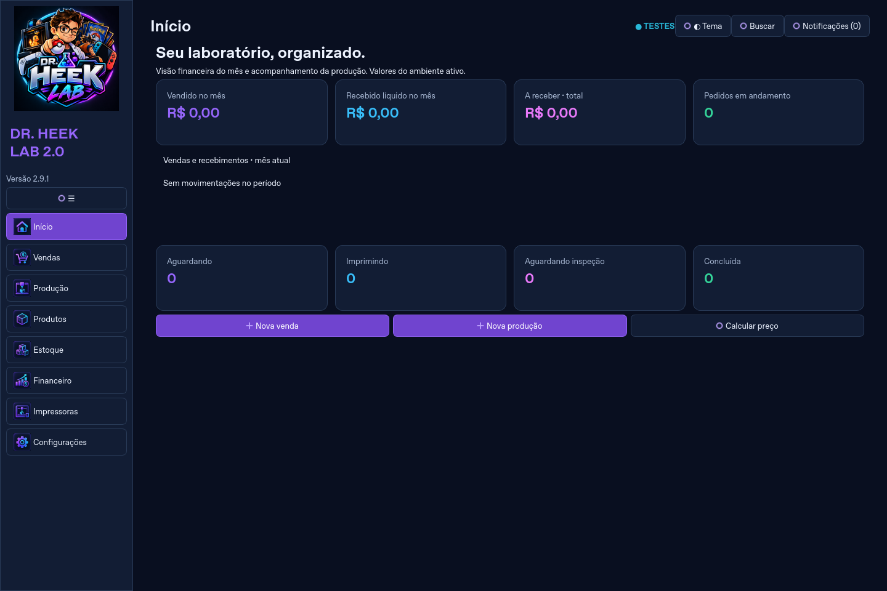
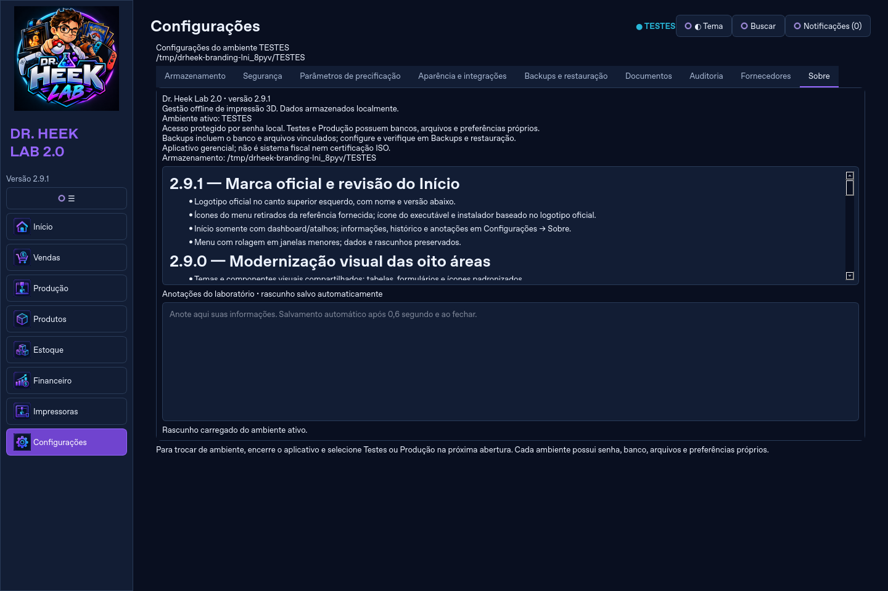
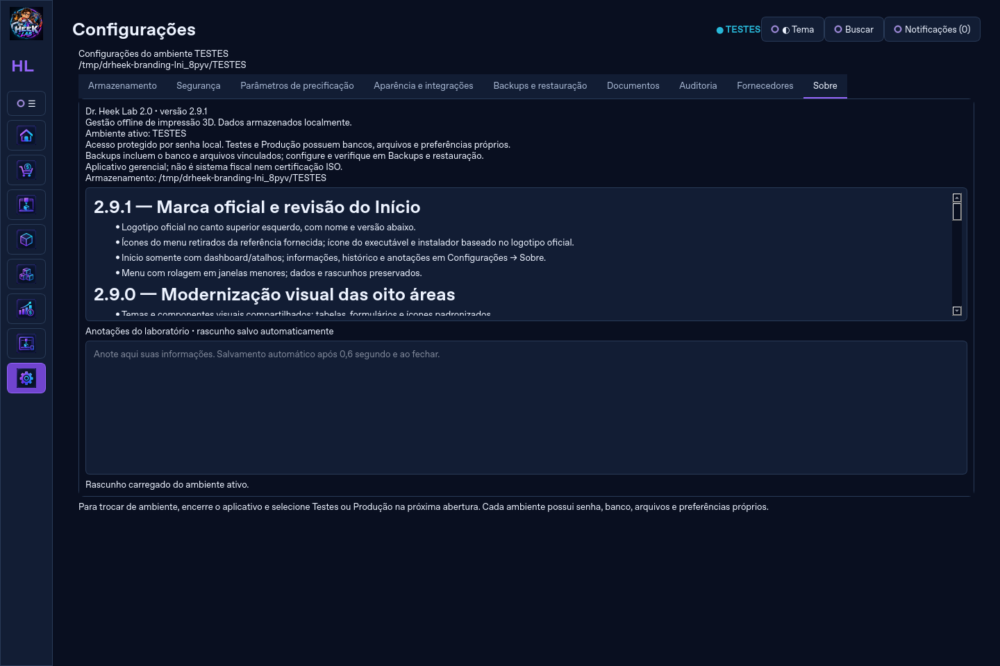

# Dr. Heek Lab 2.9.1 — ajustes finais de identidade

O ZIP fornecido pelo usuário contém o logotipo oficial PNG 1254 × 1254 e a folha JPEG dos oito ícones. O PNG empacotado preserva todos os pixels do original. A folha de ícones foi copiada sem alterar seus bytes; a interface exibe as regiões correspondentes, sem as legendas da folha. O ICO contém tamanhos 16, 24, 32, 48, 64, 128 e 256 pixels.

- Logotipo no canto superior esquerdo, com nome e versão abaixo.
- Ícones correspondentes às oito áreas, mantendo nomes, acessibilidade e navegação.
- Menu recolhível e com rolagem para janelas menores.
- Início somente com dashboard e atalhos; alerta amarelo e informações inferiores retirados dessa tela.
- Configurações → Sobre reúne informações, histórico e anotações; rascunhos antigos preservados.
- Executável principal e instalador usam o ICO oficial. O ícone também é aplicado à janela/aplicativo.
- Nenhuma fórmula, regra de negócio ou migração foi alterada.

Validação local: 255 testes aprovados, zero falhas/erros/pulos, em 66,52 s. Inclui verificação dos oito ícones carregados, logo, versão, navegação e acesso ao menu em 780 × 560. Capturas reais usando um ambiente temporário de TESTES vazio:

Para repetir: `QT_QPA_PLATFORM=offscreen .venv/bin/python tools/capture_branding.py`.
