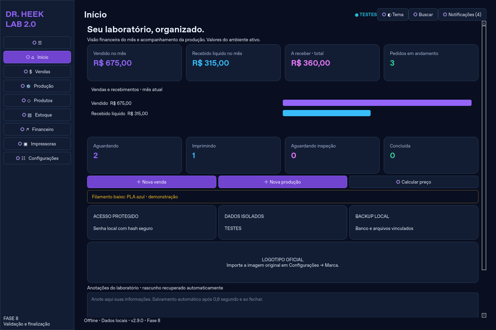
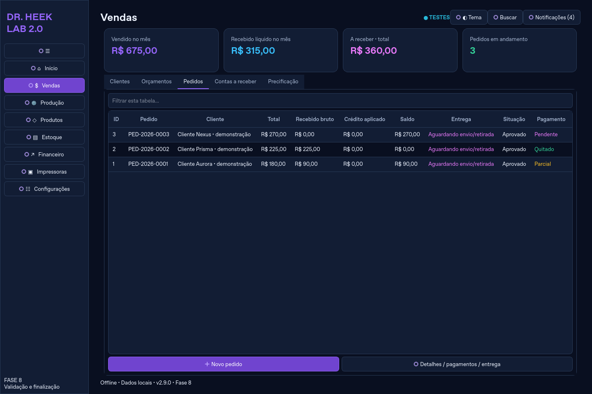
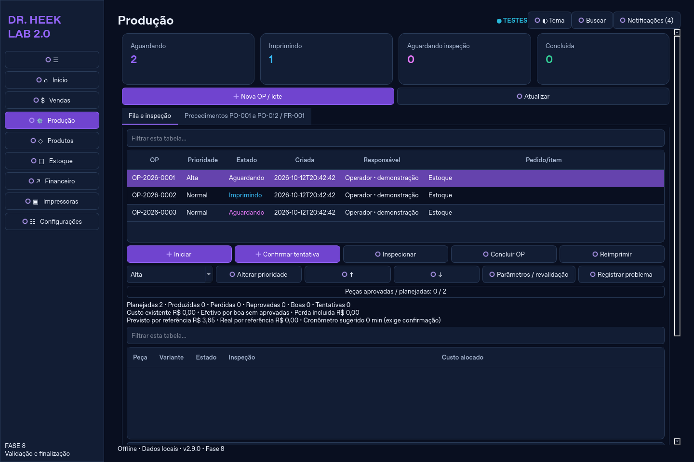
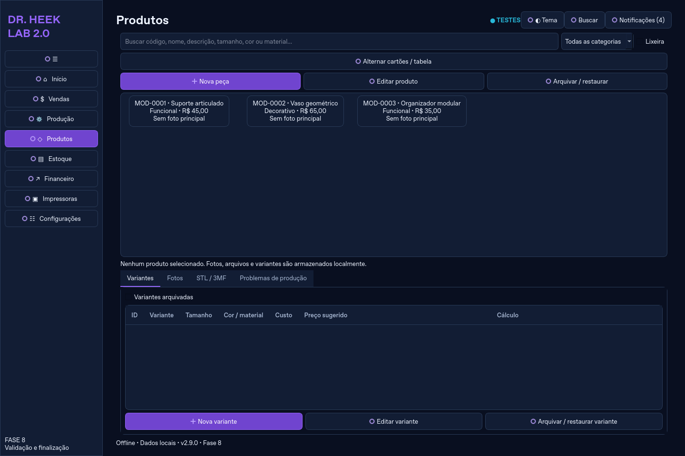
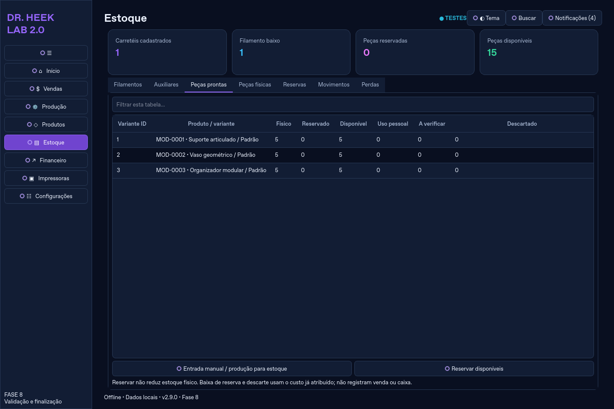
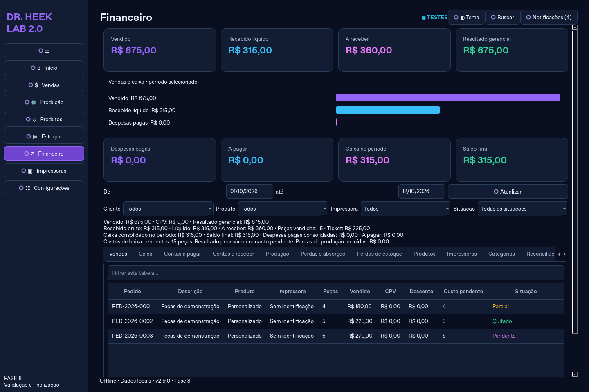
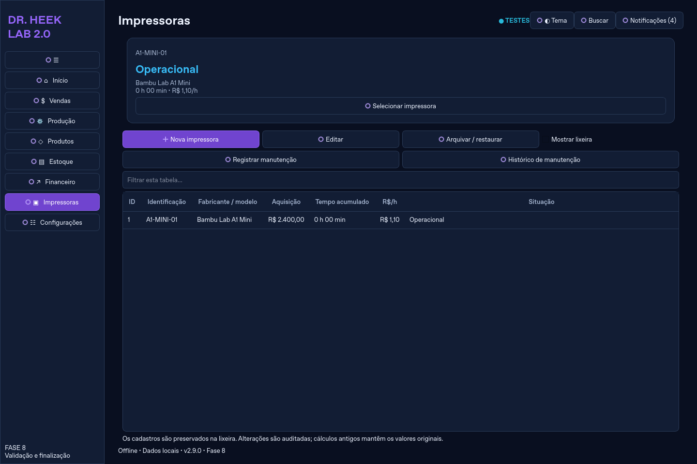
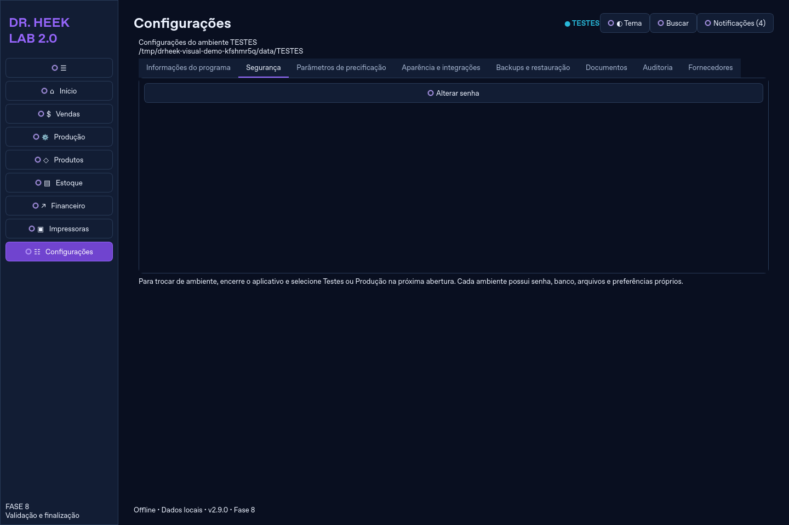

# Modernização visual — Dr. Heek Lab 2.9.0

Esta revisão aplica uma identidade compartilhada às oito áreas. As capturas usam dados fictícios criados pelas APIs reais em um diretório temporário de TESTES; nenhum dado do usuário foi utilizado ou alterado.

| Área | Apresentação |
|---|---|
| Início | Indicadores de vendas/recebimentos do mês, contas a receber totais, produção por estado, gráfico comparativo e atalhos existentes |
| Vendas | Resumo financeiro, filtros locais por tabela, clientes/orçamentos/pedidos/recebíveis e precificação preservados |
| Produção | Quatro estados com cores, fila filtrável, progresso de peças aprovadas contra planejadas, inspeção e histórico |
| Produtos | Galeria, categoria e preço, botão Nova peça, alternância para tabela com seleção sincronizada, variantes/fotos/STL/3MF |
| Estoque | Carretéis cadastrados, filamento baixo, peças reservadas/disponíveis, tabelas e movimentações |
| Financeiro | Oito indicadores extraídos do relatório existente, gráfico de vendas/recebimentos/despesas no período, filtros e relatórios |
| Impressoras | Cartões com identificação/modelo/estado/horas/custo por hora, seleção da impressora e manutenção na tabela existente |
| Configurações | Seções para segurança, aparência/integrações, precificação, backup/restauração, documentos, auditoria, fornecedores e informações |

## Componentes

`visual.py` centraliza paleta, fontes, espaçamento, temas claro/escuro, cartões, faixas de indicadores, gráficos, estilo dos botões, ícones vetoriais e tabelas. `FormDialog` mantém formulários e validações comuns com espaçamento padronizado. Confirmações existentes usam o tema compartilhado e conservam seus critérios de segurança. `presentation.py` integra os componentes às páginas e utiliza exclusivamente relatórios de domínio e consultas de leitura. Os filtros de texto apenas ocultam linhas; não reordenam nem trocam os identificadores dos registros.

Os gráficos exibem valores reais do período e uma mensagem quando não há movimentações. As barras comparam a magnitude; o rótulo conserva o sinal e o valor monetário exato. Não há estimativa artificial de produtividade. O progresso da produção é a contagem real de peças aprovadas contra planejadas, não uma previsão de tempo.

## Preservação

Nenhuma migração, fórmula financeira, regra de estoque/produção, senha, criptografia, auditoria ou documento histórico foi alterado. Os caminhos de cadastro, edição, arquivamento/restauração, pagamentos, entregas, inspeção, compras, exportações, backup e atualização continuam existentes. Fornecedores são consultados dos registros atuais; continuam editados nas compras/filamentos de origem.

## Capturas

Os arquivos abaixo mostram a aplicação Qt executada, não mockups.

### Início

### Vendas

### Produção

### Produtos

### Estoque

### Financeiro

### Impressoras

### Configurações

## Limitações de referência

A segunda imagem de referência não estava disponível nesta tarefa. A paleta e a hierarquia seguem a descrição textual. O logotipo oficial permanece importável; não foi substituído por uma imagem inventada. As peças de demonstração das capturas não possuem fotos importadas; a importação de fotos é coberta pelos testes existentes. A avaliação no computador do proprietário continua necessária para conferir DPI, monitor e uso prático.

## Validação local

- Suíte completa final: **254 testes aprovados**, sem falhas, erros ou pulos (71,63 s).
- Após a coluna de pagamento: **8 testes aprovados**, incluindo pendente/parcial/quitado, identidade dos registros após filtro e alternância galeria/tabela.
- Teste integrado 2.9.0: **passed**, cobrindo autenticação, pedidos, pagamentos, PDFs, produção/inspeção, estoque, caixa/CPV, CSV/Excel, persistência e backup criptografado.
- Navegação nas oito áreas em **780 × 560**, mantendo acesso por rolagem. Temas claro/escuro e menu recolhível preservados.
- Capturas executadas em **1440 × 960**. Para repetir: `QT_QPA_PLATFORM=offscreen .venv/bin/python tools/capture_visual.py`.

A primeira execução de empacotamento foi interrompida para incluir a correção de atualização dos filtros após alternar a lixeira. O pacote usa o nome neutro `DrHeekLab-Windows-2.9.0`; o resultado do workflow estabelece sua validação automatizada.

- Correção específica para Windows: cartões com altura mínima de 100 pixels, independentemente da métrica da fonte. Após a correção, 19 testes locais de interface/validação passaram; o teste existente de tamanho mínimo foi preservado.

## Windows — entrega validada

**254 testes aprovados, 0 falhas, 0 erros, 0 pulos** no Windows. O executável empacotado e o instalador passaram pelos testes integrados e por instalação/reinstalação, backup pré-atualização, preservação do banco/arquivos, backup sem interface, criação/remoção da tarefa agendada e desinstalação. SHA-256 do instalador, aplicativo e auxiliar de atualização conferidos após o download.

- Código compilado: `c37b967a04fd227771a74cd86dcee5aec31659f3`.
- Execução aprovada: https://github.com/d28ty8rky9-star/drheeklab/actions/runs/38306782123 .
- Pacote: https://github.com/d28ty8rky9-star/drheeklab/actions/runs/38306782123/artifacts/11772568668 .
- Após extrair o ZIP, execute `installer/DrHeekLab-2.9.0-Fase8-Setup.exe`.
- Cópia local verificada: `dist/windows-2.9.0/installer/DrHeekLab-2.9.0-Fase8-Setup.exe`.

A avaliação prática no computador do proprietário, incluindo DPI/monitor, usuário comum e máquina sem Python, permanece pendente. A aprovação acima é automatizada em runner Windows; não substitui essa avaliação.
