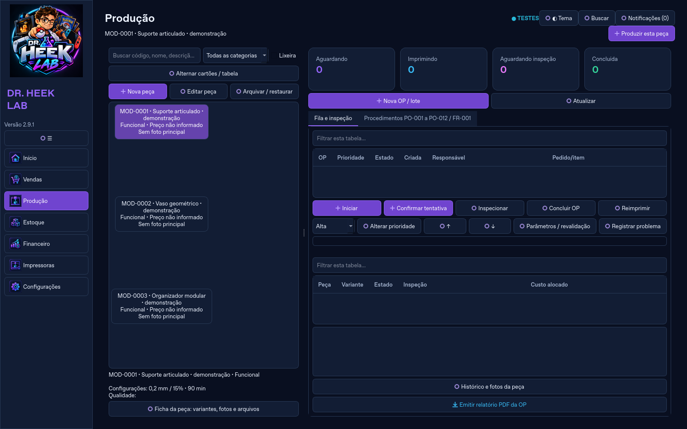
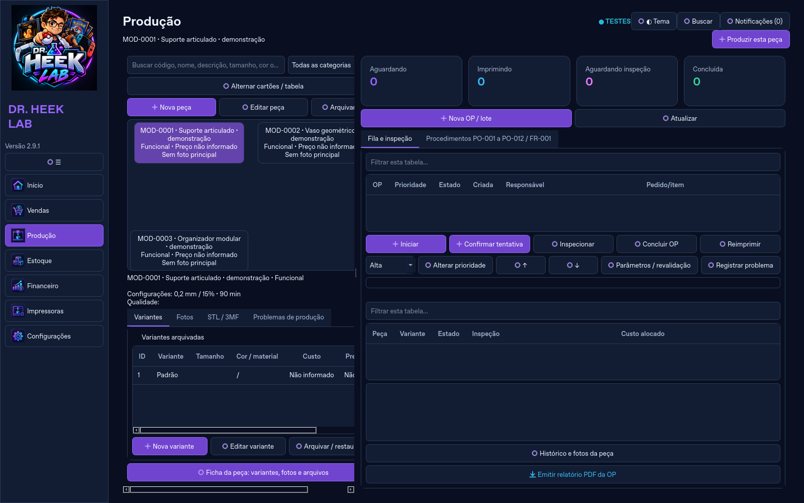

# Produção: escolher a peça e produzir

Produtos e Produção passam a ser uma única área no menu, denominada Produção. Uma tela mostra o catálogo à esquerda e a fila/inspeção à direita. O menu agora possui sete áreas.

1. Selecione a peça na galeria ou tabela.
2. Clique em Produzir esta peça.
3. O formulário seleciona a variante escolhida, o arquivo preferencial e as recomendações cadastradas de impressora, filamento, parâmetros e tempo. Confira a quantidade, o responsável e os demais campos e salve.
4. A ordem aparece na fila da mesma tela. Início, confirmação de consumo/tempo, inspeção, conclusão e histórico conservam as regras existentes.

A ficha da peça, com variantes/fotos/STL/3MF, fica recolhida e pode ser aberta no mesmo painel. Cadastro, edição, arquivamento, projetos, lote misto, procedimentos e relatórios foram preservados. Peças prontas compradas continuam podendo ser cadastradas e movimentadas em Estoque; produzir exige um arquivo ativo e não cria uma ordem para peças arquivadas. Nenhuma migração, cálculo ou regra financeira/estoque foi alterada.

Preparar o formulário não grava dados nem consome filamento. A criação da OP utiliza as validações originais; não confirma automaticamente consumo ou qualidade.

Validação local: 257 testes completos aprovados. Dois testes adicionais do fluxo foram executados novamente após destacar o botão principal e cobrir seu clique real. Testes de navegação/busca foram ajustados às sete áreas, conservando as verificações dos dados e fluxos.

Capturas com dados fictícios temporários. Reproduzir: `QT_QPA_PLATFORM=offscreen .venv/bin/python tools/capture_workshop.py`.

## Entrega sob solicitação

Atualizações e pull requests executam testes Windows. O job de empacotamento somente é habilitado por workflow_dispatch com gerar_pacote=true, após pedido explícito. Não foi gerado ZIP ou instalador para esta alteração. O último instalador entregue ainda corresponde à interface anterior; esta revisão é do código-fonte no GitHub.
